<!-- Profile README for github.com/otaviobarros. The cards in assets/ are generated in the octa.software look; light and dark follow your GitHub theme. -->

<a href="https://octa.software">
  <picture>
    <source media="(prefers-color-scheme: dark)" srcset="assets/header-dark.svg">
    
  </picture>
</a>

> **otaviobarros** `approved` · Hi, I’m Otavio. I lead engineering teams, build products, and spend my spare hours on tools that make AI-written code worth trusting.

`// about` I’ve spent my career building for the web and helping engineers grow. Now a lot of code is written by agents, and the questions feel familiar. Is the goal clear? Is the feedback honest? Did someone check the work before it shipped? I like building the tools and habits that answer yes: agents with **clear boundaries**, work that **explains itself**, and **reviews that tell the truth**.

### `// projects` Things I’m building

<a href="https://github.com/otaviobarros/hobbots">
  <picture>
    <source media="(prefers-color-scheme: dark)" srcset="assets/project-hobbots-dark.svg">
    
  </picture>
</a>

<a href="https://github.com/otaviobarros/agent-engineering">
  <picture>
    <source media="(prefers-color-scheme: dark)" srcset="assets/project-agent-engineering-dark.svg">
    
  </picture>
</a>

<a href="https://domoflow.com.br">
  <picture>
    <source media="(prefers-color-scheme: dark)" srcset="assets/project-domoflow-dark.svg">
    
  </picture>
</a>

### `// career` The short log

<a href="https://octa.software/#career">
  <picture>
    <source media="(prefers-color-scheme: dark)" srcset="assets/career-dark.svg">
    
  </picture>
</a>

### `// writing` Things I’m thinking about

<a href="https://octa.software/writing/allow-ask-never/">
  <picture>
    <source media="(prefers-color-scheme: dark)" srcset="assets/writing-dark.svg">
    
  </picture>
</a>

### `// say hello` Let’s build something worth trusting.

<a href="https://octa.software/#contact">
  <picture>
    <source media="(prefers-color-scheme: dark)" srcset="assets/contact-dark.svg">
    
  </picture>
</a>

  <a href="https://octa.software"><b>octa.software</b></a> ·
  <a href="https://www.linkedin.com/in/otavio-barros">LinkedIn</a> ·
  <a href="https://x.com/obarros">X @obarros</a> ·
  <a href="https://hobbots.app">hobbots.app</a> ·
  <a href="https://domoflow.com.br">domoflow.com.br</a> ·
  <a href="mailto:otavio@octa.software">otavio@octa.software</a>

<b>Leia em português</b>

 

**Agentes escrevem o código. Eu garanto que ele ~~suba~~ mereça subir.**

Olá, sou o Otavio. Lidero times de engenharia, crio produtos e, nas horas vagas, desenvolvo ferramentas para que possamos confiar no código escrito por IA.

Passei minha carreira desenvolvendo para a web e ajudando outros devs a crescerem. Hoje, boa parte do código é escrita por agentes, e as perguntas continuam as mesmas. O objetivo está claro? O feedback é sincero? Alguém revisou o trabalho antes do deploy? Gosto de criar ferramentas e hábitos que permitem responder sim a todas elas: agentes com **limites claros**, trabalho que **se explica sozinho** e **revisões que dizem a verdade**.

- **[Hobbots](https://github.com/otaviobarros/hobbots)**: um espaço de trabalho para agentes de IA que roda no seu computador.
- **[agent-engineering](https://github.com/otaviobarros/agent-engineering)**: skills para Codex e Claude Code, do “faça isso” a um PR em draft já revisado.
- **[DomoFlow](https://domoflow.com.br)**: uma recepcionista com IA no WhatsApp para hotéis e pousadas pequenas.
- **Texto:** [Allow, Ask, Never: permissões para agentes de IA](https://octa.software/pt/writing/allow-ask-never/)

O site completo, em português: **[octa.software/pt](https://octa.software/pt/)**

